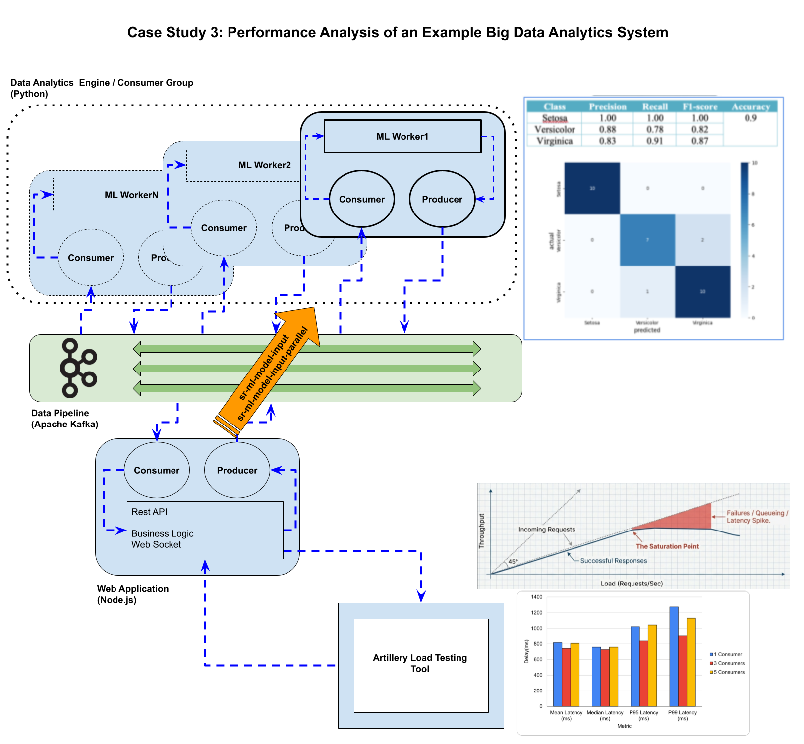

# Building A Web-Based Big Data Analytics Infrastructure

In this project, a web application that includes Apache Kafka and a data analytics engine has been developed. 

Users log in, receive a JWT, and are redirected to a page that matches their role. Admins get a dashboard that sends 
inputs to an ML model and shows the prediction live via Socket.IO.

The system was further evaluated to assess both its predictive accuracy and overall performance.

## Project structure

```
├── index.html            # Redirects to login.html
├── login.html            # Login form; auto-redirects if a valid token exists
├── dashboard.html        # Admin dashboard (role 1) with ML model form
├── unauthorized.html     # "Access Denied" page
└── js/
    └── scripts.js        # Login, logout, access control, customer list, UI helpers
```





## Roles

| Role (`role` in JWT) | Redirects to |
|---|---|
| `1` (admin) | `dashboard.html` |
| `2` | `registered-user.html` |
| `3` | `moderator.html` |
| anything else | `unauthorized.html` |


## How it works

1. `login.html` sends `POST /login` with `{ username, password }`.
2. The server returns `{ token }`. The token is stored in `localStorage` and decoded in the browser with `jwt-decode` to read `role`, `exp` and user details.
3. Protected pages check that the token exists, has not expired and has the right role. Otherwise the user is sent back to the login page.
4. On the dashboard, "Decision Making" opens the model form. Submitting it calls `POST /api/ml-model/predictions`; the result arrives through the Socket.IO `model-result` event and is displayed on the page.
## Backend requirements

The front end expects a server (same origin) that provides:

| Endpoint | Purpose |
|---|---|
| `POST /login` | Returns `{ token }` (a JWT with `role`, `username`, `firstname`, `lastname`, `exp`) |
| `POST /api/ml-model/predictions` | Accepts `{ sepal_length, sepal_width }` with a `Bearer` token |
| `/socket.io/socket.io.js` | Socket.IO client, emitting a `model-result` event with `{ result }` |
| `GET http://localhost:3000/api/customers` | Optional; used by the customer list button, if present on a page |


## Postgresql DB


```sql
--The database structure of the application
CREATE DATABASE dss;
----------------------------
create table users
(
  id        serial primary key,
  username  varchar(50)  not null unique,
  password  varchar(255) not null,
  firstname varchar(50)  not null,
  lastname  varchar(50)  not null,
  role      smallint
);
```

* Register an admin user by using the registration endpoint in ./app/rest-api.http
```json
{
  "username": "admin",
  "password": "1",
  "firstname": "Joe",
  "lastname": "Roe",
  "role": 1
}
```


## Apache Kafka


### Setting Up KRaft-Based Kafka Messaging System

* Go to https://kafka.apache.org/quickstart/
* Binary download: 4.1.x (https://kafka.apache.org/community/downloads/)
* Extract Kafka

**For Linux/OSX-based Systems**

```shell

cd /kafka

#Generate a Cluster UUID 
$ KAFKA_CLUSTER_ID="$(bin/kafka-storage.sh random-uuid)"

#Format Log Directories
$ ./bin/kafka-storage.sh format --standalone -t $KAFKA_CLUSTER_ID -c config/server.properties

#Start the Kafka Server
$ ./bin/kafka-server-start.sh config/server.properties
```

**For Windows-based Systems:**

```shell
cd C:\kafka

REM Generate and capture cluster ID
FOR /F %i IN ('bin\windows\kafka-storage.bat random-uuid') DO SET KAFKA_CLUSTER_ID=%i

REM Format storage
bin\windows\kafka-storage.bat format -t %KAFKA_CLUSTER_ID% -c config\kraft\server.properties

REM Start Kafka
bin\windows\kafka-server-start.bat config\kraft\server.properties

```


### Testing Apache Kafka

[Consumers and Producers](../case-study-3/utils)


## Web Application

[Web Application](./app)

## Data analytics engine

The system includes a Python-based logistic regression model to make predictions on the Iris dataset.

[Train ML Model](./ml/logistic-regression/train-save-evaluate.py)

[Use ML Model For Predictions](./ml/logistic-regression/load-predict.py)


## **Parallel Processing**

To enable parallel message processing in Apache Kafka, a topic must be configured with **multiple partitions**.

Define a new topic named `sr-ml-model-input-parallel`
with a partition count **greater than or equal to the number of consumers** in the same consumer group.

### **Required Modifications**

- Update the **web backend (producer)** to publish messages to the new topic.
- Update the **ML model consumers** to:
    - Subscribe to the new topic
    - Use the same **consumer group ID** (to enable load balancing across instances)

### **Running Multiple Consumer Instances**

To run multiple instances of the consumer within the same group:

- Enable the `Allow multiple instances` option in your IDE’s run configuration.
- Start multiple instances of the consumer application.

---

## **Performance Evaluation**

### **Load Testing**

Run `server-for-load-testing.js` and `load-predict-for-load-testing.py` applications.

Conduct experiments using different numbers of consumer instances:

- 1 consumer
- 2 consumers
- ... consumers

For each configuration, measure and record the **processing delay (latency)**.

```bash
cd ~/final-exam-project-draft/tests
artillery run cs3-load-10clients-predict-v1.yml
```

